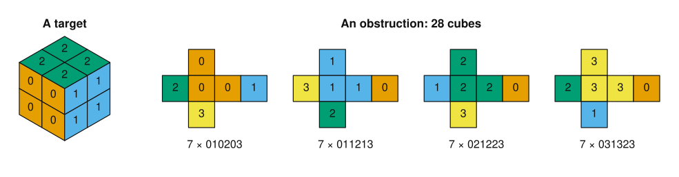
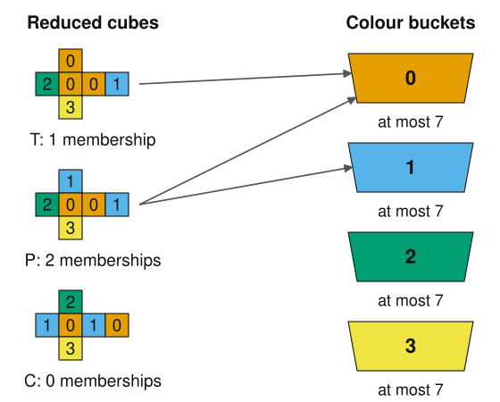

# A sharp threshold for three-colour targets from four-colour cubes

- [Paper (PDF)](paper/macmahon-four-to-three.pdf) and [LaTeX](paper/macmahon-four-to-three.tex).
- [Main Lean results](ThreeColour/Family.lean), [physical model](ThreeColour/PhysicalDefs.lean), and [formalisation guide](ThreeColour/README.md).
- [Independent theorem statements](Challenge.lean) and [completed proof entry point](Solution.lean).
- [Provenance, scope and AI disclosure](formalization.yaml).

**Every collection of 29 four-colour cubes contains eight that build an
exactly-three-colour target. For a fixed palette, exactly two collections of
28 cubes fail.** Each consists of seven copies of each of four varieties; the two
collections are mirror images.

Each source cube uses all four colours. A target is a 2×2×2 cube with
monochromatic exterior faces using exactly three colours; internal faces
need not match. Colourings related by a proper rotation are the same
*variety*; reflecting a cube is not an allowed move. Collections may repeat varieties.
A trichromatic corner has three different face colours.

This answers the threshold question in Problem 2 of
[Berkove, Eickemeyer and Schulman, *The 4-Color Cubes Puzzle* (2018)](https://math.colgate.edu/~integers/s68/s68.pdf).



*Marked vertices are monochromatic corners. In panel B, opposite faces of
the target have equal colours, so its hidden bottom face has colour 2.
In panel C, $a,b,c$ are distinct colours.*

## Proof idea

The proof reduces the 68 varieties to 38 by replacing cubes with varieties
whose corner types are contained in theirs. This preserves unsolvability.
The retained types are triple-corner ($T$), pair-type ($P$), and checkerboard ($C$).
A cube belongs to colour bucket $a$ if it has at least two of the three
corner types $aab$, with $b\ne a$. The examples show one cube of each type;
colour permutations give the other bucket memberships.



Eight cubes in any bucket can build a three-colour target, so an unsolvable
collection has at most seven in each bucket. Let $n_T,n_P$ count the $T$ and
$P$ cubes, including repeats. Counting memberships by cube type and by bucket gives

$$n_T+2n_P\le 4\cdot7=28.$$

The proof combines this count with the corner-orientation constraints to
classify the two exceptional collections.

## Repository layout

- `paper/`: manuscript source and PDF.
- `ThreeColour/`: Lean proofs, generated geometry and formalisation guide.
- `scripts/`: geometry generation, validation, comparator and optional search.
- `data/lower-obstruction.json`: the 28-cube witness and its 120 Hall certificates.
- Root Lean files and configuration: build entry points, independent challenge,
  comparator configuration and formalisation metadata.

## Lean dependency

The project pins
[macmahon-min-universal-sets](https://github.com/jasondavies/macmahon-min-universal-sets/tree/3f854795a77cd7c902e4c5a1a5da3322f9cd44fa)
to commit `3f854795a77cd7c902e4c5a1a5da3322f9cd44fa` in both `lakefile.toml`
and `lake-manifest.json`. It reuses `MacMahon.Rotations` and its transitive
physical definitions: the 24 proper rotations, six coordinate face directions
and eight corner positions. It does not import the six-colour classification
proof. Both projects use Lean and mathlib **v4.35.0**.

A fresh clone fetches this pinned public dependency; no sibling checkout
is needed.

## Reproduce

Install [elan](https://github.com/leanprover/elan), Python 3.11 or later and
Ruby, then run:

```sh
lake exe cache get
make check
make paper  # requires latexmk and a LaTeX installation
```

`make check` audits proof sources, validates metadata and dependency pins,
regenerates geometry and figures, runs the separate Python checker, and builds
all Lean targets. The root `ThreeColour.lean` guards twenty-two axiom reports, permitting only
`propext`, `Classical.choice`, and `Quot.sound`. There is no `native_decide`.
The first Lean build takes several minutes. CI repeats these checks and runs the full
comparator on pushes and pull requests.

The public Lean results include:

| Theorem | Claim |
| --- | --- |
| `family_threshold29` | Every arbitrary indexed family of 29 four-colour cubes has a three-colour solution. |
| `family_sharp_threshold29` | Upper bound without source or target catalogues and explicit size-28 counterexample. |
| `family_least_guaranteed_size` | Least-size theorem without source or target catalogues. |
| `family_classify28_geometric` | Classification for arbitrary indexed cubes by proper-rotation equivalence to the source representatives. |
| `physical_threshold29` | Every collection of size 29 has a physical solution. |
| `physical_classify28` | Exactly the two specified size-28 collections fail. |
| `least_guaranteed_size` | 29 is the least size guaranteeing success for all larger collections. |
| `source_catalogue_complete` / `target_catalogue_complete` | Every relevant face assignment occurs up to proper rotation. |
| `source_catalogue_unique` | Distinct source indices are distinct rotation varieties. |
| `reflect_extremal` | Reflection exchanges the two extremal collections. |

`Family.lean` works with arbitrary indexed face colourings; a solution selects
eight distinct copies and proper rotations. Transport lemmas connect these
families to inventories of the 68 canonical varieties. A
[corner–rotation theorem](ThreeColour/CornerGeometry.lean), valid for any
palette, equates cyclic corner matching with matching the three exposed faces
by a proper rotation. The proof does not enumerate all collections.

## Comparator and Palomar

`Challenge.lean` imports only mathlib and independently restates nineteen
results: the threshold, sharpness and classification, catalogue coverage and
colour counts, and correctness of the rotation, exposed-face and reflection
geometry. Its nineteen deliberate `sorry` declarations are statement
placeholders. No proof module imports them; they are excluded from the
proof-development hole count.

```sh
make comparator
```

This uses the toolchain's comparator and bundled Lean, NanoDa and con-ron
kernels. Definition and statement mismatches fail before kernel replay;
the full replay can take tens of minutes. `make check` alone does not run it.
It requires `bwrap` and support for its sandbox. The repository also includes
a manually triggered Palomar preflight workflow. No registry submission or
acceptance is claimed.

## Computation and review

The [separate checker](scripts/check_three_colour_threshold.py) uses Python's
standard library and generates rotations from quarter-turns. It checks the
68-to-38 corner reduction, the printed entries in both geometric tables,
both exhibited lower obstructions, all 120 targets,
68 one-cube extensions of the first obstruction and 1,000 sampled 29-cube
collections. The extension and sample checks use only the 28 targets of
types $Q,R,D$ in the paper's restricted-target corollary. It also checks this
restriction on 1,000 sampled 28-cube collections. These finite samples do not
prove the general statements; the restricted-target corollary is proved in
the paper but is not stated as a separate Lean theorem.

The optional search uses OR-Tools CP-SAT:

```sh
python3 -m venv .venv
. .venv/bin/activate
python3 -m pip install -r requirements.txt
python3 scripts/cube_frame_search.py --palette 4 --target-colours 3 \
  --minimal --seconds 60 --workers 8 \
  --hint data/lower-obstruction.json --output /tmp/four-to-three-search.json
```

That command searches for the largest obstruction. To test size 29 and
exclude the known 28-cube obstructions among the 38 reduced varieties, run:

```sh
python3 scripts/cube_frame_search.py --palette 4 --target-colours 3 \
  --minimal --size 29 --seconds 60 --workers 8 \
  --output /tmp/four-to-three-size29.json
python3 scripts/cube_frame_search.py --palette 4 --target-colours 3 \
  --minimal --size 28 --exclude-colour-orbit data/lower-obstruction.json \
  --seconds 60 --workers 8 --output /tmp/four-to-three-exclude-extrema.json
```

Both should report `INFEASIBLE`. The checked-in fixture contains the 28-cube
witness and Hall certificates for every target; the geometric checker validates
them on each run. The Lean proof does not depend on the solver.

A literature search on November 1, 2026 found no earlier answer, but
Rosenfeld's October 2026 Geombinatorics article remains unread.
Priority has not been independently established.

AI contributions and review scope are recorded in [formalization.yaml](formalization.yaml)
and the paper's disclosure. The original GPT-6-Astra review covered an earlier
version; Claude Opus 5.5 contributed later mathematical simplifications and
review. The paper has not received independent human peer review.

Code and manuscript are distributed under the [Apache-2.0 licence](LICENSE).
